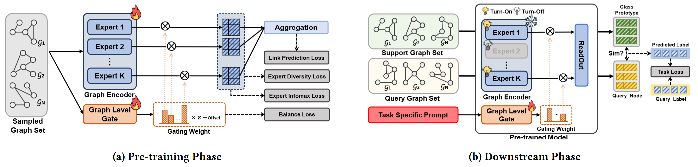
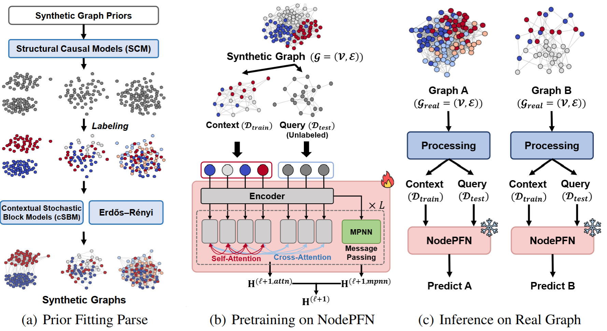
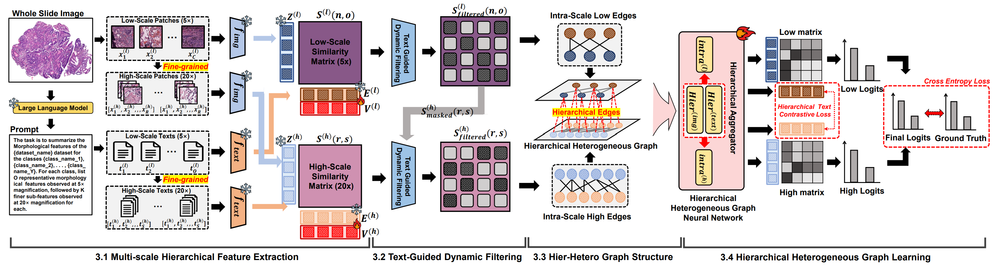
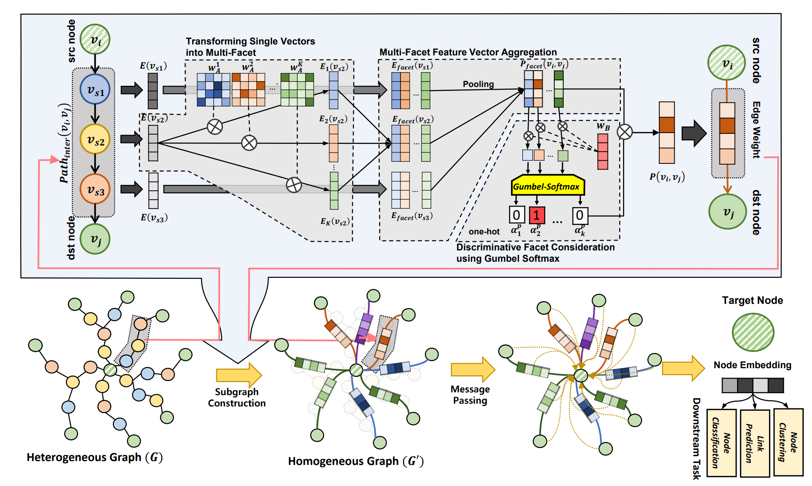

<link rel="stylesheet" href="https://fonts.googleapis.com/css2?family=Inter:wght@400;500;600;700&family=Source+Serif+4:opsz,wght@8..60,600;8..60,700&display=swap">

Hello, I’m Jongwoo Kim, a Ph.D. student in Industrial and Systems Engineering at KAIST, advised by [Prof. Mun Yong Yi](https://sites.google.com/view/myyi-kaist) and [Prof. Noseong Park](https://sites.google.com/view/npark). I work at the [Knowledge Innovation Research Center (KIRC)](https://kirc.kaist.ac.kr).

I build practical AI systems for real-world problems, focusing on:

- **World Models and JEPA**: bringing latent predictive learning to real domains such as pathology, graphs, and education.
- **Computational Pathology**: modeling the hierarchical, multi-scale structure of gigapixel slides, from local tissue patterns to the whole slide.
- **Graph Learning**: capturing the right inductive biases for graph-structured data, so that models generalize across graphs.

I’m always looking for practical challenges, regardless of domain.

## News

<ul class="news-list">
  <li>Nov 2026GraPE is accepted to <b>KDD 2027</b>.</li>
  <li>Aug 2026Knowledge World Model for learning path recommendation is accepted to <b>CIKM 2026</b>.</li>
  <li>Apr 2026FeedEval is accepted to <b>ACL 2026 Findings</b>.</li>
  <li>Jan 2026Our work on posterior predictive node classification (co-first author) is accepted to <b>ICLR 2026</b>.</li>
  <li>Sep 2025Hierarchical vision-language few-shot learning for gigapixel images (co-first author) is accepted to <b>NeurIPS 2025</b>.</li>
</ul>

## Selected Publications

† equal contribution. Full list on the <a href="/publications/">Publications</a> page.

  
  

    
GraPE: Graph Prompt Tuning via Mixture of Experts Approach.

    
<b>Jongwoo Kim</b>, Jeongwhan Choi, Seongyeub Chu, Noseong Park, Mun Yi.

    
KDDACM SIGKDD Conference on Knowledge Discovery and Data Mining (KDD), 2027

  

  
  

    
<a href="https://openreview.net/forum?id=FmxRzlu0rT">Learning Posterior Predictive Distributions for Node Classification from Synthetic Graph Priors.</a>

    
Jeongwhan Choi†, <b>Jongwoo Kim†</b>, Woosung Kang, Noseong Park.

    
ICLRInternational Conference on Learning Representations (ICLR), 2026

  

  
  

    
<a href="https://arxiv.org/abs/2505.17982">Few-Shot Learning from Gigapixel Images via Hierarchical Vision-Language Alignment and Modeling.</a>

    
Bryan Wong†, <b>Jongwoo Kim†</b>, Huazhu Fu, Mun Yi.

    
NeurIPSNeural Information Processing Systems (NeurIPS), 2025

  

  
  

    
<a href="https://dl.acm.org/doi/10.1145/3746252.3761099">Leveraging Multi-facet Paths for Heterogeneous Graph Representation Learning.</a>

    
<b>Jongwoo Kim</b>, Seongyeub Chu, Hyeongmin Park, Bryan Wong, Keejun Han, Mun Yi.

    
CIKM OralConference on Information and Knowledge Management (CIKM), 2025

  

## Education

<b>Ph.D.</b>, Industrial and Systems Engineering, KAISTAug. 2024 – Present

Advisor: Prof. Mun Yong Yi

<b>M.S.</b>, Data Science, KAISTSep. 2022 – Aug. 2024

Thesis: MicroMIL: Spatially Enhanced Multiple Instance Learning for Advanced Cancer Diagnosis in Microscopy. Advisor: Prof. Mun Yong Yi

<b>B.S.</b>, Industrial and Systems Engineering, Seoul National University of Science and Technology (Summa Cum Laude)Feb. 2016 – Aug. 2022

Advisor: Prof. Youngjung Geum

## Honors and Awards

Industrial and Social Issues Poster Contest, 3rd Place, KAISTNov. 2025

Best Paper Award, Korea Computer CongressJun. 2024

Industrial and Social Issues Poster Contest, 2nd Place, KAISTNov. 2022

ETRI Human Understanding AI Paper Contest, Minister of Science and ICT AwardJun. 2022

Capstone Design, 2nd Place, Seoul National University of Science and TechnologyDec. 2021

Superior Academic Performance, Seoul National University of Science and TechnologyAug. 2020 – Feb. 2022

## Academic Service

Conference reviewer for KDD 2024 and MICCAI 2025.

